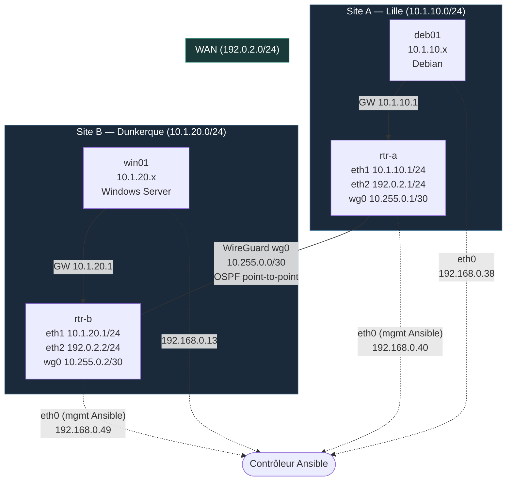

# loginord-infra

Construit une Debian (site A) et un Windows Server Core (site B) avec un rôle `baseline` :
nom d'hôte, fuseau horaire, NTP, compte admin.

## Architecture



## Prérequis sur le contrôleur

```sh
pip install pywinrm            # ou : pacman -S python-pywinrm
ansible-galaxy collection install -r requirements.yml -p collections
echo 'motdepasseduvault' > ~/.vault_pass && chmod 600 ~/.vault_pass
```

## Le seul geste manuel : rendre les VM joignables

**Debian (deb01)** — en root (`su -`, avec le tiret, sinon `/usr/sbin` n'est pas dans le PATH) :

```sh
apt install -y sudo openssh-server
useradd -m -s /bin/bash -G sudo ansible
passwd ansible
echo 'ansible ALL=(ALL) NOPASSWD:ALL' > /etc/sudoers.d/ansible
chmod 440 /etc/sudoers.d/ansible
```

et depuis le contrôleur : `ssh-copy-id ansible@<ip>`.

**Windows Server Core (win01)** — WinRM est actif par défaut ; `-q` accepte toutes les
modifications proposées, y compris `LocalAccountTokenFilterPolicy` (droits admin à distance
pour les comptes locaux autres que `Administrateur`) :

```powershell
winrm quickconfig -q
```

Adapter les IP dans `inventory/hosts.yml`.

## Secrets

`vault/secrets.yml` (chiffré) doit contenir :

```yaml
vault_win_password: "<mot de passe Administrateur Windows>"
vault_admin_password: "<mot de passe du compte admin Windows>"
vault_admin_password_hash: "<sortie de : openssl passwd -6>"
vault_dsrm: "<mot de passe DSRM (restauration AD)>"
vault_pwd_init: "<mot de passe initial des utilisateurs AD>"
```

```sh
ansible-vault edit vault/secrets.yml
```

## Lancer

```sh
ansible all -m ping -l linux
ansible all -m ansible.windows.win_ping -l windows
ansible-playbook site.yml
ansible-playbook site.yml   # le 2e passage doit afficher changed=0
```

## Routeurs (MC02)

`rtr-a` et `rtr-b` (Alpine) : rôles `router` (IP, routage, nftables), `wireguard` (tunnel `wg0`)
et `frr` (OSPF). Ansible passe par `eth0`, que ces rôles ne touchent jamais.

| | rtr-a | rtr-b |
|---|---|---|
| eth1 (LAN) | 10.1.10.1/24 | 10.1.20.1/24 |
| eth2 (WAN) | 192.0.2.1/24 | 192.0.2.2/24 |
| wg0 | 10.255.0.1/30 | 10.255.0.2/30 |

- Réseau : `ifupdown-ng`, un fichier par interface dans `/etc/network/interfaces.d/`
  (`lan`, `wan`, `wg0`). C'est l'outil natif d'Alpine, sans systemd.
- WireGuard : `wg-quick` (via `use wireguard-quick`), `Table = off` et `AllowedIPs = 0.0.0.0/0` :
  aucune route statique, c'est OSPF qui les pose.
- MTU : les réseaux internes passent dans le vxlan Proxmox (1400), d'où un tunnel à 1320.
- Clés privées : `vault/wireguard.yml` (même mot de passe que `vault/secrets.yml`), clés
  publiques dans `inventory/host_vars/`.

```sh
ansible-playbook site.yml -l routers
ssh ansible@192.168.0.40 sudo vtysh -c '"show ip ospf neighbor"' -c '"show ip route ospf"'
```

## Ajouter un site

Créer le groupe `site_c` dans `inventory/hosts.yml` et `inventory/group_vars/site_c.yml`.
Le rôle ne change pas.

## Rôles par hôte

| Hôte | baseline | router | wireguard | frr | ssh_hardening | ad_dc |
|------|:--------:|:------:|:---------:|:---:|:-------------:|:-----:|
| deb01 | ✅ | — | — | — | ✅ | — |
| win01 | ✅ | — | — | — | — (WinRM) | ✅ |
| rtr-a | ✅ | ✅ | ✅ | ✅ | ✅ | — |
| rtr-b | ✅ | ✅ | ✅ | ✅ | ✅ | — |

> 🔲 = à créer · ✅ = en place

## Administration à distance (MC03)

Rôle `ssh_hardening` (Linux uniquement) :

- `/etc/ssh/sshd_config.d/10-durcissement.conf` : `PermitRootLogin no`, `PasswordAuthentication no`, `AllowGroups {{ ssh_hardening_group }}`, `MaxAuthTries 3`, `LoginGraceTime 30`, `X11Forwarding no`
- Handler : `sshd -t` → `systemctl reload ssh` (validation avant rechargement)
- Le groupe `ssh_hardening_group` (défaut : `ssh-admins`) changera en MC6 pour un groupe AD

Windows — PowerShell Remoting (WinRM déjà actif) :

```powershell
Enter-PSSession -ComputerName win01 -Credential (Get-Credential)
Invoke-Command -ComputerName win01 -ScriptBlock { hostname }
```

```sh
# Vérification Linux
ssh root@<ip>                              # doit être refusé
ssh -o PubkeyAuthentication=no admin@<ip> # doit être refusé
ssh admin@<ip>                             # doit passer
journalctl -u ssh --since today            # lire les tentatives
```

## Active Directory en code (MC04)

Rôle `ad_dc` sur `domain_controllers` (win01), variables dans `inventory/group_vars/domain_controllers.yml` :

1. **Forêt** : rôle AD DS, forêt `loginord.internal` (pas de `.local`), redémarrage, puis attente
   que l'AD réponde (`Get-ADDomain` en `retries`/`until`).
2. **Annuaire** : `LogiNord > {Lille,Dunkerque} > {Utilisateurs,Serveurs}`, plus `Groupes`, `Admins`,
   `Départs`. Les OU de site sont générées par `ad_sites × ad_site_ous`. Groupes en AGDLP
   (`GG_*` = qui, `DL_*` = quoi), utilisateurs de test (`update_password: on_create`, `groups: set`).
3. **DNS** : zones inverses intégrées à AD, `trackr` en A + PTR, redirecteurs.
4. **DHCP** : rôle, autorisation dans AD (`Add-DhcpServerInDC`), étendue Dunkerque + options
   (passerelle, DNS = IP du DC en 10.1.x, suffixe). PowerShell idempotent via `$Ansible.Changed`.

```sh
ansible-playbook site.yml -l domain_controllers
ansible-playbook site.yml -l domain_controllers   # changed=0
```

```powershell
nslookup trackr.loginord.internal
nslookup 10.1.20.20
Get-DhcpServerv4Scope
Get-ADOrganizationalUnit -Filter * | select DistinguishedName
```
