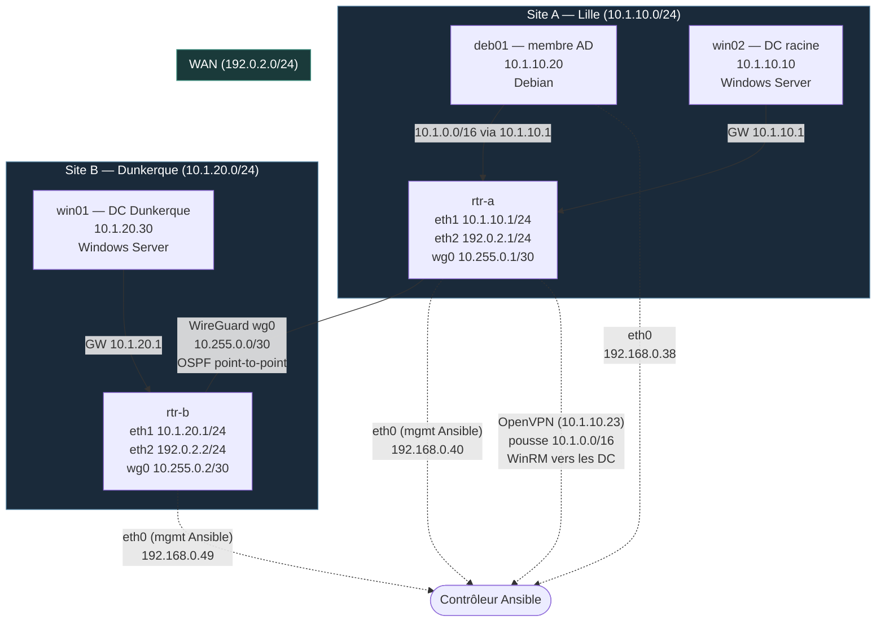

# loginord-infra

Construit une Debian (site A) et un Windows Server Core (site B) avec un rôle `baseline` :
nom d'hôte, fuseau horaire, NTP, compte admin.

## Architecture



## Prérequis sur le contrôleur

```sh
pip install pywinrm            # ou : pacman -S python-pywinrm
ansible-galaxy collection install -r requirements.yml -p collections
echo 'motdepasseduvault' > ~/.vault_pass && chmod 600 ~/.vault_pass
```

## Le seul geste manuel : rendre les VM joignables

**Debian (deb01)** — en root (`su -`, avec le tiret, sinon `/usr/sbin` n'est pas dans le PATH) :

```sh
apt install -y sudo openssh-server
useradd -m -s /bin/bash -G sudo ansible
passwd ansible
echo 'ansible ALL=(ALL) NOPASSWD:ALL' > /etc/sudoers.d/ansible
chmod 440 /etc/sudoers.d/ansible
```

et depuis le contrôleur : `ssh-copy-id ansible@<ip>`.

**Windows Server Core (win01)** — WinRM est actif par défaut ; `-q` accepte toutes les
modifications proposées, y compris `LocalAccountTokenFilterPolicy` (droits admin à distance
pour les comptes locaux autres que `Administrateur`) :

```powershell
winrm quickconfig -q
```

Adapter les IP dans `inventory/hosts.yml`.

## Secrets

`vault/secrets.yml` (chiffré) doit contenir :

```yaml
vault_win_password: "<mot de passe Administrateur Windows>"
vault_admin_password: "<mot de passe du compte admin Windows>"
vault_admin_password_hash: "<sortie de : openssl passwd -6>"
vault_dsrm: "<mot de passe DSRM (restauration AD)>"
vault_pwd_init: "<mot de passe initial des utilisateurs AD>"
```

```sh
ansible-vault edit vault/secrets.yml
```

## Lancer

```sh
ansible all -m ping -l linux
ansible all -m ansible.windows.win_ping -l windows
ansible-playbook site.yml
ansible-playbook site.yml   # le 2e passage doit afficher changed=0
```

## Routeurs (MC02)

`rtr-a` et `rtr-b` (Alpine) : rôles `router` (IP, routage, nftables), `wireguard` (tunnel `wg0`)
et `frr` (OSPF). Ansible passe par `eth0`, que ces rôles ne touchent jamais.

| | rtr-a | rtr-b |
|---|---|---|
| eth1 (LAN) | 10.1.10.1/24 | 10.1.20.1/24 |
| eth2 (WAN) | 192.0.2.1/24 | 192.0.2.2/24 |
| wg0 | 10.255.0.1/30 | 10.255.0.2/30 |

- Réseau : `ifupdown-ng`, un fichier par interface dans `/etc/network/interfaces.d/`
  (`lan`, `wan`, `wg0`). C'est l'outil natif d'Alpine, sans systemd.
- WireGuard : `wg-quick` (via `use wireguard-quick`), `Table = off` et `AllowedIPs = 0.0.0.0/0` :
  aucune route statique, c'est OSPF qui les pose.
- MTU : les réseaux internes passent dans le vxlan Proxmox (1400), d'où un tunnel à 1320.
- Clés privées : `vault/wireguard.yml` (même mot de passe que `vault/secrets.yml`), clés
  publiques dans `inventory/host_vars/`.

```sh
ansible-playbook site.yml -l routers
ssh ansible@192.168.0.40 sudo vtysh -c '"show ip ospf neighbor"' -c '"show ip route ospf"'
```

## Ajouter un site

Créer le groupe `site_c` dans `inventory/hosts.yml` et `inventory/group_vars/site_c.yml`.
Le rôle ne change pas.

## Rôles par hôte

| Hôte | baseline | router | wireguard | frr | ssh_hardening | ad_dc | ad_member |
|------|:--------:|:------:|:---------:|:---:|:-------------:|:-----:|:---------:|
| deb01 | ✅ | — | — | — | ✅ | — | ✅ |
| win02 | ✅ | — | — | — | ✅ (OpenSSH) | ✅ racine | — |
| win01 | ✅ | — | — | — | ✅ (OpenSSH) | ✅ réplica | — |
| rtr-a | ✅ | ✅ | ✅ | ✅ | ✅ | — | — |
| rtr-b | ✅ | ✅ | ✅ | ✅ | ✅ | — | — |

> 🔲 = à créer · ✅ = en place

## Administration à distance (MC03)

Rôle `ssh_hardening` (Linux uniquement) :

- `/etc/ssh/sshd_config.d/10-durcissement.conf` : `PermitRootLogin no`, `PasswordAuthentication no`, `AllowGroups {{ ssh_hardening_group }}`, `MaxAuthTries 3`, `LoginGraceTime 30`, `X11Forwarding no`
- Handler : `sshd -t` → `systemctl reload ssh` (validation avant rechargement)
- Le groupe local `ssh_hardening_group` (défaut : `ssh-admins`) contient le compte admin et le
  compte Ansible : sans lui, `AllowGroups` couperait Ansible au premier rechargement de sshd
- MC06 : sur les membres du domaine, `ssh_hardening_ad_groups` ajoute des groupes AD (voir plus bas)

Windows — PowerShell Remoting (WinRM déjà actif) :

```powershell
Enter-PSSession -ComputerName win01 -Credential (Get-Credential)
Invoke-Command -ComputerName win01 -ScriptBlock { hostname }
```

```sh
# Vérification Linux
ssh root@<ip>                              # doit être refusé
ssh -o PubkeyAuthentication=no admin@<ip> # doit être refusé
ssh admin@<ip>                             # doit passer
journalctl -u ssh --since today            # lire les tentatives
```

## Active Directory en code (MC04)

Rôle `ad_dc` sur `domain_controllers` (racine : win02), variables dans `inventory/group_vars/domain_controllers.yml` :

1. **Forêt** : rôle AD DS, forêt `loginord.internal` (pas de `.local`), redémarrage, puis attente
   que l'AD réponde (`Get-ADDomain` en `retries`/`until`).
2. **Annuaire** : `LogiNord > {Lille,Dunkerque} > {Utilisateurs,Serveurs}`, plus `Groupes`, `Admins`,
   `Départs`. Les OU de site sont générées par `ad_sites × ad_site_ous`. Groupes en AGDLP
   (`GG_*` = qui, `DL_*` = quoi), utilisateurs de test (`update_password: on_create`, `groups: set`).
3. **DNS** : zones inverses intégrées à AD, `trackr` en A + PTR, redirecteurs.
4. **DHCP** : rôle, autorisation dans AD (`Add-DhcpServerInDC`), étendue du site + options
   (passerelle, DNS, suffixe). PowerShell idempotent via `$Ansible.Changed`.

```sh
ansible-playbook site.yml -l domain_controllers
ansible-playbook site.yml -l domain_controllers   # changed=0
```

```powershell
nslookup trackr.loginord.internal
nslookup 10.1.20.20
Get-DhcpServerv4Scope
Get-ADOrganizationalUnit -Filter * | select DistinguishedName
```

## Sites AD et réplication (MC05)

Deux DC, un par site : `win02` (Lille) crée la forêt, `win01` (Dunkerque) la rejoint.
La racine est le premier hôte de `domain_controllers` (`ad_forest_root`), le site AD de
chaque machine vient de son groupe de site (`ad_site` dans `group_vars/site_a.yml`, `site_b.yml`).

**Geste manuel sur win01 (ISO française), avant le premier passage** : après la promotion,
les comptes locaux disparaissent et Ansible se connecte avec l'administrateur du domaine,
`Administrator` (forêt créée depuis une ISO anglaise). On donne ce nom au compte local pour
que les mêmes identifiants marchent avant et après :

```powershell
Rename-LocalUser -Name Administrateur -NewName Administrator
```

Le mot de passe de cet `Administrator` local doit être `vault_win_password`, comme sur win02
(l'`Administrator` du domaine, c'est l'ancien compte local de win02 : il a gardé ce mot de passe).

Ordre des tâches (`roles/ad_dc/tasks/main.yml`), sur les deux DC en même temps :

1. **Forêt** (racine).
2. **DNS client des DC** : toutes les cartes réseau pointent vers les DNS de l'AD, jamais vers
   un DNS Internet. Racine : `10.1.10.10`. win01 : `10.1.10.10` puis `10.1.20.30`.
3. **Sites** (racine) : `Default-First-Site-Name` renommé en `Lille`, `Dunkerque` créé, les
   sous-réseaux `10.1.10.0/24 → Lille` et `10.1.20.0/24 → Dunkerque`, le lien
   `Lille-Dunkerque` (coût 100, toutes les 15 min au lieu de 180, notification de changement
   activée : bonus). Tout est dans `ad_sites` : un 3e site = une entrée de plus.
4. **Annuaire** (racine) : répliqué vers les autres DC, on ne l'écrit qu'à un endroit.
5. **Promotion** de win01 (`microsoft.ad.domain_controller`, `site_name: Dunkerque`) : il naît
   directement dans le bon site.
6. **DNS** : zones et enregistrements sur la racine (intégrés à AD, répliqués), redirecteurs
   sur chaque DC.
7. **DHCP** : chaque DC sert l'étendue de son site, avec lui-même en premier DNS et l'autre
   DC en secours. Dunkerque distribue ses adresses même tunnel coupé.

**Pourquoi win01 interroge d'abord win02, puis lui-même** : avant la promotion, seul win02
connaît le domaine. Après, si win01 se répondait d'abord à lui-même, il pourrait rester sur une
copie de la zone qu'il n'a pas encore reçue (« îlot DNS ») ; en interrogeant d'abord le DC
racine, il trouve toujours les enregistrements à jour. Tunnel coupé, la requête vers win02
expire et win01 se rabat sur son propre DNS : c'est plus lent, mais ça répond. Les postes de
Dunkerque, eux, reçoivent win01 en premier (DHCP) : ils ne dépendent jamais du tunnel.

**Heure** : Kerberos refuse plus de 5 min d'écart. La racine (PDC) se synchronise sur les
serveurs NTP, les autres DC suivent la hiérarchie du domaine (`NT5DS`). Le rôle `baseline`
choisit d'après le rôle de la machine (`windows_domain_role`). Au passage qui suit la
promotion, win01 passe en `NT5DS` : c'est un `changed` attendu, une seule fois.

**Réplication : change notification** (« notification de modification »). Dans un site, un DC
modifié prévient ses partenaires (~15 s) qui viennent chercher le changement : c'est le
comportement par défaut. Entre sites, par défaut, pas de notification mais une **réplication
planifiée** (*scheduled replication*) : les DC se synchronisent à la fréquence du lien (180 min
par défaut, 15 ici), le trafic est regroupé et compressé, pensé pour des WAN lents. Avec
`notification: true`, le lien se comporte comme en intra-site (*inter-site change
notification*) : bit 1 `USE_NOTIFY` de l'attribut `options` du lien, absent de la console
graphique. Gain : un compte désactivé à Lille l'est presque tout de suite à Dunkerque. Coût :
plus de petits envois, non compressés, négligeable sur deux DC. Le planning reste un filet de
sécurité si une notification se perd (tunnel coupé). À ne pas confondre avec l'**urgent
replication** (verrouillage de compte, etc.), envoyée sans délai, mais qui ne traverse les
sites que si la notification est activée sur le lien.

**Une seule carte par DC : le LAN.** Au départ, les DC avaient aussi une carte de gestion, et la
démo « couper le lien » ne coupait rien. Le serveur DNS publie une IP pour chaque carte où il
écoute. `RegisterThisConnectionsAddress` ne règle que le client DNS : `win02` résolvait donc aussi
en `192.168.0.30`. Comme les deux DC partageaient ce réseau, Windows préférait l'adresse
joignable directement, et réplication, LDAP et Kerberos passaient à côté du tunnel. Désormais :

- les cartes de gestion des DC sont retirées dans Proxmox (geste manuel) ;
- Ansible passe par les IP LAN via le VPN (OpenVPN pousse `10.1.0.0/16`) ;
- Internet passe par la passerelle LAN, avec le NAT du routeur ;
- le rôle `ad_dc` supprime les enregistrements `win01`/`win02` autres que l'IP LAN.

Contrôle : `Resolve-DnsName win02` ne donne que `10.1.10.10`.

**Pare-feu** : la chaîne `forward` des routeurs (MC02) laisse passer tout le trafic entre LAN et
`wg0`, donc DNS, Kerberos, LDAP, SMB et la plage RPC dynamique (49152-65535) passent.

```sh
ansible-playbook site.yml -l windows
ansible-playbook site.yml -l windows       # changed=0 (après le passage NT5DS)
ansible-playbook playbooks/verif_ad.yml    # site, dcdiag, replsummary, comptes vus par chaque DC
```

```powershell
nltest /dsgetsite              # win01 : Dunkerque
repadmin /replsummary          # 0 échec
repadmin /showrepl
repadmin /syncall /AdeP        # forcer la réplication sans attendre
dcdiag /q                      # silence = aucune erreur
Get-ADUser alice.martin -Server win01
```

SYSVOL est répliqué à part, par DFS-R : comparer `\\win02\SYSVOL` et `\\win01\SYSVOL`, et le
journal « DFS Replication ».

### Démo : couper le lien

```sh
ssh ansible@192.168.0.49 sudo ifdown wg0          # 1. couper le tunnel (rtr-b)
# Le VPN arrive à Lille : tunnel coupé, win01 n'est plus joignable qu'à la console Proxmox
```

```powershell
# 2. sur win01 : le DC de Dunkerque crée un compte et authentifie seul
New-ADUser coupure.test -Server localhost -AccountPassword (Read-Host -AsSecureString) -Enabled $true
runas /user:LOGINORD\coupure.test cmd
Get-ADUser coupure.test -Server win02             # échoue : win02 injoignable
```

```sh
ssh ansible@192.168.0.49 sudo ifup wg0            # 3. rétablir
```

```powershell
# 4. sur win02 : le compte arrive (immédiat avec la notification, sinon repadmin /syncall /AdeP)
Get-ADUser coupure.test
```

## Linux dans l'AD : Kerberos et SSSD (MC06)

Rôle `ad_member` sur le groupe `ad_members` (deb01), variables dans
`inventory/group_vars/ad_members.yml`. Le domaine (`ad_domain`, `ad_admin`…) est dans
`group_vars/all/ad.yml`, partagé avec les DC.

**Geste manuel : une carte LAN pour deb01.** deb01 n'avait que sa carte de gestion (`ens18`) :
il ne voyait aucun DC. Dans Proxmox, ajouter `net1` sur `vmbr1`, VLAN 10 (comme win02). Elle
apparaît en `ens19` (sinon corriger `iface` dans `host_vars/deb01.yml`). `baseline` lui donne
`10.1.10.20/24` et la route `10.1.0.0/16 via 10.1.10.1`, sans passerelle par défaut.

| Brique | Rôle |
|---|---|
| realmd | découvre le domaine et orchestre la jonction |
| adcli | crée le compte ordinateur dans AD et la keytab (`/etc/krb5.keytab`) |
| SSSD | va chercher identités et groupes dans AD, authentifie (Kerberos), garde un cache |
| NSS · PAM | branchent SSSD sur le système : `id`, login, ssh, sudo |
| krb5 | les outils Kerberos : `kinit`, `klist` |

Ordre :

1. **Heure** (`baseline`) : chrony suit les DC (`ad_member_dcs`, le DC du site d'abord), plus
   Internet. Kerberos refuse au-delà de 5 min d'écart.
2. **DNS** : `resolv.conf` pointe vers les DC. La carte de gestion est en DHCP : un hook
   `dhclient` l'empêche de remettre ses DNS au prochain bail.
3. **Jonction** : `realm join --computer-ou=OU=Serveurs,OU=Lille,…`, seulement si
   `realm list` ne montre pas déjà le domaine. Le mot de passe passe par l'entrée standard
   (`stdin`, `no_log`), jamais dans la ligne de commande (visible dans `ps`).
4. **SSSD** (`sssd.conf` écrit par Ansible, après realm) : noms courts (`alice.martin`),
   `/home/%u`, cache des mots de passe, `ad_site` pour viser le DC du site,
   `access_provider = simple` + `simple_allow_groups` (qui entre), `ad_gpo_access_control =
   permissive`. Répertoire personnel créé à la première connexion (`pam-auth-update --enable
   mkhomedir`).
5. **sudo** : `/etc/sudoers.d/ad-admins`, validé par `visudo -cf` avant d'être posé.
6. **SSH** (`ssh_hardening`) : `AllowGroups ssh-admins gg_admins_linux gg_developpeurs`, et un
   `Match Group` qui n'autorise le mot de passe qu'aux groupes AD. Les comptes locaux restent à
   clé.

| Compte AD | Groupe | Connexion | sudo |
|---|---|:---:|:---:|
| test2.test2 | GG_Admins_Linux | ✅ | ✅ |
| bob.leroy | GG_Developpeurs (bonus) | ✅ | — |
| alice.martin, test.test | autres | refusée | — |

**Points à expliquer à l'oral** :

- **Kerberos** : l'utilisateur prouve son identité au KDC (le DC) et reçoit un ticket maître, le
  TGT. Avec lui il demande un ticket de service (pour deb01), qu'il présente. Le mot de passe ne
  circule jamais sur le réseau. D'où les deux prérequis : l'heure (les tickets sont horodatés)
  et le DNS (les KDC sont trouvés par enregistrements SRV, `_kerberos._tcp.loginord.internal`).
- **Les groupes AD arrivent en minuscules.** SSSD est insensible à la casse avec AD et présente
  `gg_admins_linux`. sudo s'en accommode, mais `AllowGroups` et `Match Group` de sshd comparent
  à la lettre : `GG_Admins_Linux` n'y correspondrait jamais. Les templates passent tout en
  `lower`.
- **Deux verrous** : sshd (`AllowGroups`) refuse avant même le mot de passe ; SSSD
  (`simple_allow_groups`) refuse au niveau PAM, pour tout service (ssh, console, `su`).
- **Pourquoi `Match Group` à la fin du fichier** : un `Match` vaut jusqu'à la fin du fichier
  inclus. Placé avant d'autres directives, il les enfermerait dans sa condition.
- **`ad_gpo_access_control`** : par défaut (`enforcing`), SSSD applique les GPO « Autoriser
  l'ouverture de session » de Windows. Une GPO pensée pour les postes peut bloquer les Debian sans
  rien dans la config Linux. `permissive` : évaluée, journalisée, jamais bloquante.
- **UID calculés depuis le SID** (`ldap_id_mapping`) : aucun attribut POSIX à remplir dans AD,
  et le même UID sur toutes les Debian.
- **Le cache** : DC injoignable, les comptes déjà connus entrent encore (exigence Dunkerque). Le
  revers : un salarié parti aussi, hors ligne, et un changement de groupe met jusqu'à ~1 h 30 à
  être vu. `sss_cache -E` vide le cache : une étape du départ d'un salarié (MC13).
- **L'heure des DC Windows et chrony** : W32Time annonce une incertitude (*root dispersion*)
  qui gonfle entre deux synchronisations. Avec l'intervalle par défaut des DC (jusqu'à 1024 s),
  win01 annonçait 16 s : chrony le rejetait (test 7 de la RFC 5905, `chronyc ntpdata` :
  `NTP tests : 111 110 0000`), alors que l'écart réel était de quelques ms. Correctif des deux
  côtés : les Windows se resynchronisent toutes les 64 s (`baseline_win_ntp_max_poll`), et
  chrony accepte jusqu'à 16 s au lieu de 3 (`maxdistance`).
- **Inscription DNS** : SSSD inscrit lui-même la machine (A + PTR) par une mise à jour sécurisée
  (GSS-TSIG, compte machine), 0 à 5 min après son démarrage. Il lui faut le nom complet
  (`ad_hostname`) : `hostname` ne rend que `deb01`, et la mise à jour échouait.
- **Nom d'hôte** : au-delà de 15 caractères, le nom NetBIOS du compte ordinateur est tronqué
  (collisions possibles). `deb01` : aucun risque.

```sh
ansible-playbook site.yml -l domain_controllers  # crée GG_Admins_Linux, GG_Developpeurs, bob.leroy
ansible-playbook site.yml -l deb01
ansible-playbook site.yml -l deb01               # changed=0
ansible-playbook playbooks/verif_linux_ad.yml    # realm, id et décision d'accès de chaque compte
```

Sur deb01 :

```sh
realm list
host -t SRV _ldap._tcp.loginord.internal     # le DNS de l'AD répond
chronyc sources                              # les DC : * = choisi, - = utilisable
host deb01.loginord.internal                 # inscrit par SSSD (A + PTR)
id test2.test2                               # ses groupes AD
getent group gg_admins_linux
sssctl user-checks alice.martin              # simule une connexion : refusée, et pourquoi
kinit test2.test2 && klist                   # Kerberos seul, sans SSSD
journalctl -u sssd                           # détails : debug_level = 6 dans [domain/…]
```

### Démo : un admin entre, un autre est refusé

```sh
ssh test2.test2@10.1.10.20      # mot de passe AD, home créé
sudo -l                         # (ALL : ALL) ALL
ssh bob.leroy@10.1.10.20        # entre, mais sudo refusé
ssh alice.martin@10.1.10.20     # refusé
```

```sh
# sur deb01 : retrouver le refus
journalctl -u ssh --since -5min | grep alice   # « not allowed because none of user's groups are listed in AllowGroups »
```
